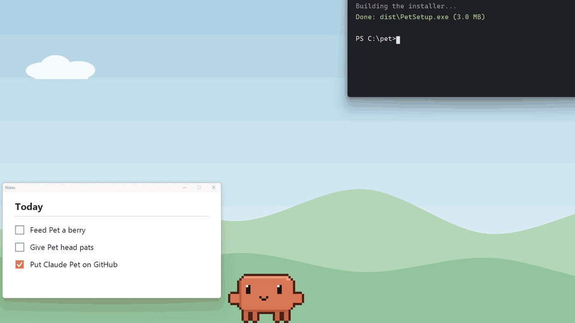
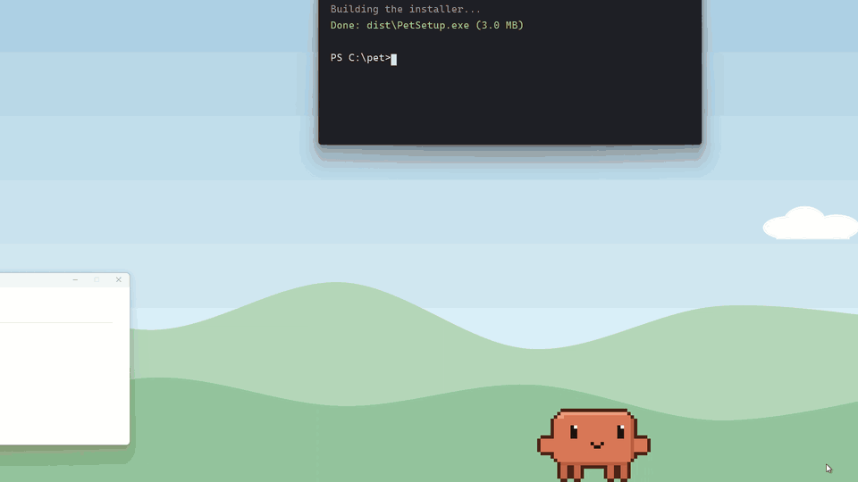
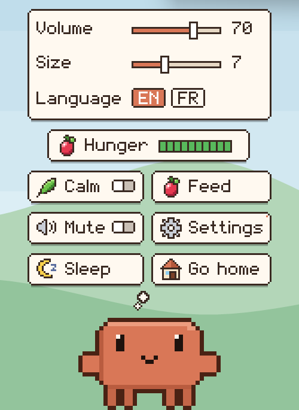

# Claude Pet

Un petit Claude en pixel art qui vit sur ton bureau Windows. Il se balade en bas de tes écrans, grimpe sur tes
fenêtres, s'accroche à ton pointeur, boit son café, code sur son petit ordinateur et fait la sieste quand tu t'absentes.

🇬🇧 [Read in English](README.md)

> **Projet de fan, non officiel.** Claude Pet n'est ni fait, ni approuvé, ni soutenu par Anthropic.





⬇ **[Télécharger la démo complète](https://github.com/Ixorak/claude-pet/raw/master/docs/demo.mp4)** (MP4, 75 secondes, 1,9 Mo ; Pet y parle anglais, sa langue par défaut)

## Ce qu'il fait

- **Il vit sur ton bureau.** Il marche, court, s'assoit, s'étire et regarde autour de lui, en bas de chaque écran. Il
  passe d'un écran à l'autre là où ils se touchent.
- **Il grimpe.** Il saute sur tes fenêtres, escalade leurs côtés et les bords des fenêtres agrandies. Il suit une
  fenêtre que tu déplaces, et tombe quand tu la fermes.
- **Il joue avec ton pointeur.** Passe le pointeur au-dessus de lui : il lève les bras, saute, l'attrape et se balance.
  Laisse le pointeur immobile : il grimpe dessus et s'y assoit en balançant les jambes. Secoue la souris pour le faire
  tomber.
- **On peut l'attraper.** Fais-le glisser (il se balance), lâche-le pour le lancer. Il rebondit sur les bords de
  l'écran, voit des étoiles, puis se relève.
- **Il adore les caresses.** Maintiens le clic droit sur lui et fais des allers-retours : il ferme les yeux, rougit,
  ronronne et fait des cœurs.
- **Il a faim.** Après 3 heures d'ordinateur allumé, il dit « J'ai faim ! » et ralentit. Donne-lui une baie.
- **Il s'occupe.** Il boit un café, tape sur son ordinateur, écoute de la musique, lit un livre et souffle des bulles de
  savon. Même assis sur ton pointeur.
- **Il a des humeurs.** Il sourit juste après une caresse, a l'air de s'ennuyer au bout d'un moment, et devient triste
  si tu l'ignores trop longtemps. Il cligne des yeux.
- **Il dort** quand tu quittes ton ordinateur pendant 3 minutes, et se réveille en s'étirant à ton retour.
- **Il a une maison :** le raccourci « Pet » sur ton bureau. Il sort par sa porte au démarrage, et y retourne quand tu
  le renvoies chez lui.
- **Il ne gêne pas.** Quand un jeu ou une vidéo est en plein écran sur son écran, il creuse le sol et ressort sur un
  écran libre.
- **Il est léger.** Une appli native, sans rien à installer en plus, environ 0,2 % d'un cœur du processeur quand il est
  tranquille. Aucun accès à Internet, aucun pistage.

## Installer

1. Télécharge **PetSetup.exe** depuis la [dernière version](https://github.com/Ixorak/claude-pet/releases/latest).
2. Lance-le. Il s'installe pour ton utilisateur Windows seulement (pas besoin de droits administrateur), ajoute le
   raccourci « Pet » sur ton bureau (c'est sa maison) et démarre Pet avec Windows.

L'installateur n'est pas signé : Windows SmartScreen peut afficher un avertissement. Clique sur **Informations
complémentaires**, puis **Exécuter quand même**.

Il faut Windows 11, 64 bits (Windows 10 devrait marcher, mais n'a pas été essayé).

**Désinstaller :** Paramètres → Applications → Applications installées → Claude Pet → Désinstaller. Tout part :
l'appli, les raccourcis, le démarrage automatique et les réglages.

## Comment t'en servir



- **Double-clique sur Pet** pour ouvrir son menu :
  - **Nourrir** : une baie pend au bout du pointeur. Il court et saute pour l'attraper, ou clique pour la poser par
    terre.
  - **Calme** : il bouge lentement, s'assoit plus souvent et arrête de sauter partout.
  - **Muet** : plus aucun son.
  - **Dormir** : il dort jusqu'à ce que tu cliques sur lui.
  - **Réglages** : volume, taille et langue.
  - **Rentrer à la maison** : il rentre dans sa maison et l'appli se ferme.
- **Fais-le glisser** avec le clic gauche, et lâche-le pour le lancer.
- **Maintiens le clic droit** sur lui et fais des allers-retours pour le caresser.
- **Clique** sur lui pour lui donner une petite tape. Cinq tapes d'affilée et il se fâche un moment. Une baie ou des
  caresses le calment.
- L'**icône de notification** (près de l'horloge) propose Calme, Muet, Langue et Rentrer à la maison.

Pet ne prend que les clics sur ses propres pixels : partout ailleurs, tes clics passent au travers.

### Langue

Pet parle anglais par défaut, et aussi français. Change dans **Réglages → Langue (EN / FR)**, ou depuis l'icône de
notification. L'installateur le démarre dans la langue de l'installation.

## Le compiler toi-même

Il faut :

- le [SDK .NET 10](https://dotnet.microsoft.com/download)
- Visual Studio 2022 ou ses Build Tools, avec **Développement Desktop en C++** (pour la compilation native)
- [Inno Setup 6](https://jrsoftware.org/isinfo.php), pour l'installateur : `winget install JRSoftware.InnoSetup`

Puis, dans PowerShell :

```powershell
.\build.ps1
```

Ça fabrique `out\app\ClaudePet.exe` et `dist\PetSetup.exe`. `.\build.ps1 -NoSetup` ne fait que l'appli. Tu peux
aussi double-cliquer sur `build.bat`.

Comment c'est fait : du C# compilé en exe natif (Native AOT), du Win32 simple avec des fenêtres transparentes
(« layered »), sans bibliothèque d'interface. Pet, ses animations, sa maison et ses sons sont tous fabriqués par le
code : il n'y a aucun fichier d'image ni de son. Les commentaires du code sont en français.

| Dossier | Ce qu'il contient |
|---|---|
| `src/ClaudePet/Core` | Son comportement : cerveau, physique, souris, fenêtres, humeurs, faim, occupations |
| `src/ClaudePet/Art` | Le pixel art, dessiné par le code (poses, objets, police pixel, maison) |
| `src/ClaudePet/Audio` | Les sons 8 bits, fabriqués au démarrage |
| `src/ClaudePet/Gfx`, `Native` | Les fenêtres transparentes et l'accès à Win32 |
| `tools/AssetGen` | Fabrique l'icône de la maison et des planches des poses |
| `installer` | Le script Inno Setup |

## Licence

Le code est sous [licence MIT](LICENSE). Cette licence ne couvre que le code de ce dépôt. « Claude » et le logo de
Claude appartiennent à Anthropic, et ce projet n'est pas lié à Anthropic.

Conçu par [Ixorak](https://github.com/Ixorak), fabriqué avec [Claude Code](https://claude.com/claude-code).
